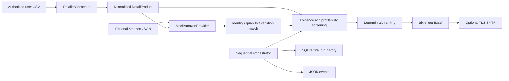

# Architecture

## V0.3 preparation (offline only)

New provider contracts separate catalog, fees, eligibility and demand evidence;
an injected transport policy bounds attempts/timeouts and reserves usage atomically
in SQLite before attempts. No HTTP adapter or live selector is registered.
SQLite backup tooling and proposed timer include retention and tested no-overwrite
restore. See [preparation handoff](V03_PREPARATION.md) and
[backup proposal](SQLITE_BACKUPS.md). Deployed V0.2 remains unchanged.

## V0.1 baseline (verified before V0.2 changes)

Python 3.12 runs a sequential, environment-configured job. `pipeline` loads the legacy CSV and applies deterministic eligibility, exact-match, $5 profit and 50% acquisition ROI gates. `reporting` atomically exports an openpyxl workbook; `mailer` optionally sends it using verified TLS. `history` persists running/succeeded/failed execution metadata in SQLite. `orchestrator` coordinates these modules and emits JSON events. Both CLI entry points work. All 29 baseline tests passed before implementation.

No network service, queue or database server is necessary. SMTP is optional. Jobs run once by default; positive intervals repeat after completion. This architecture remains the compatibility path.

## V0.2 discovery path

`CsvConnector` streams `RetailProduct` models through explicit normalization (GTIN check digits, positive package quantities, finite Decimal costs, timezone-aware evidence). `AmazonProvider` is a protocol; `MockAmazonProvider` implements local fixture matching with no network access. `Match` separates identity confidence from seller eligibility. `discovery` combines evidence gates, Decimal economics and deterministic ranking, then passes report rows to the existing Excel and job-history boundaries.

The orchestrator selects the legacy or discovery workflow from configuration. No extra process, server or runtime dependency is introduced. Retailer/API integrations, AI supervision and dashboards remain future layers.

## Financial model

All V0.2 money is USD per unit and uses Decimal internally. Acquisition cost = buy + inbound shipping + preparation + packaging + sales tax + other cost. Net profit = sale − acquisition − referral − fulfillment − storage − other transaction expenses. ROI = net / acquisition × 100. With zero new expenses this exactly reproduces V0.1. Source tax and shipping inputs are supplied amounts, not automatically calculated rates.

Referral is a fixed supplied amount unless a fractional referral rate is explicitly provided. Break-even = acquisition + sale costs + fixed referral, or (acquisition + sale costs) / (1 − referral rate). Maximum purchase price is the lesser of the profit and ROI constraints after other acquisition costs; negative results are clamped to zero, which indicates no feasible positive purchase at that price. Assumes the supplied fixed costs remain constant and percentage referral is the only price-dependent fee. It is an estimate, not a dynamic marketplace fee quote.

## Screening and ranking

Source identity/provenance/URL, positive buy price and package size, confirmed stock, exact match, seller eligibility, complete costs, sale price, supplied demand/competition and fresh source/marketplace timestamps are required. A match alone is never eligibility. Missing costs are not zero; invalid rows remain visible. One unit must fit the inventory budget. Failing rows are rejected with explicit reasons; passing rows are REVIEW only, never purchase-ready.

Confidence is a transparent evidence score (not a statistical probability): ten equally weighted 10-point components for valid source normalization, exact match, source provenance, marketplace provenance, verified cost basis, eligibility, freshness, demand presence, competition presence and no blocking issues. Mock scores cap at 50 and remain estimates regardless of fixture assertions. Ranking = 0.25 × ROI capped at 200 + 0.30 × confidence + 10 × min(monthly sales, 300)/300 + 10/(1+offers) + 10 × (1 − acquisition/budget). Only passing rows receive a score. Scores are rounded to two decimals; ASIN/name stabilize ties. These initial heuristics are documented, not a validated demand prediction model.

Budget units = floor(budget / acquisition) independently per candidate; the workbook does not allocate a $500 basket across all candidates. Exact matching confidence is distinct from evidence confidence. The top sheet contains at most the configured count (20 by default). Excel's 31-character sheet-name limit requires `Data Quality and Missing Info` as the abbreviated quality-sheet title.

## Failure and resource boundaries

Connector/header/provider failures fail the execution and persist a failed history record. Row-level bad/missing evidence is a rejected result and does not fail the report job. Missing data and stale mocks may therefore yield a successful execution with zero review candidates. Atomic report replacement preserves earlier reports on generation failure. Email/final job outcome is recorded in SQLite after workbook generation, so the job-summary sheet explicitly shows the report phase instead of claiming delivery succeeded.

Discovery caps source rows at 10,000 by default. CSV is streamed; candidate results, fixture listings and workbook cells remain memory-resident. This fits a small-job design, not unbounded catalog processing. Large live catalogs will require indexed/paginated providers and measured memory limits. No network retrieval, per-product LLM or background database service is used.

## Proposed operations enforcement

Offline backup now admits copies against an application byte budget/free-space
reserve under a shared lock, and restore verifies schema/data before publication.
Monitor checks both filesystems and backup usage. An optional local dispatcher
supports explicit opt-in HTTPS heartbeat and redacted failure/recovery messages;
its unit is dry-run/offline by default. An independent missed-heartbeat receiver
must run outside this VM. No units are installed and no notifications sent.
See OPERATIONS_WATCHDOG.md for dependencies, limitations and deployment gates.

## Optional Keepa contract adapter (live disabled)

KeepaAdapter maps explicit US ASIN replies into separate catalog, Amazon-price,
rank and lower-bound demand evidence. Unknown seller eligibility/fees and listing
economics remain missing. UsageLedger bounds attempts; a shared SQLite record paces
requests. Optional permission-bounded memory cache preserves timestamps; no raw
payload persistence. KeepaHttpTransport is dormant behind a false code gate. No
production selector, live calls, credential lookup or deployment is enabled.

## Controlled DEMO composition

`app.demo` composes CsvConnector, MockAmazonProvider, discover and write_report
with an explicit fixture clock and isolated Config, bypassing environment-loaded
SMTP/provider settings and job-history writes. It produces ignored DEMO XLSX,
JSON and Markdown plus sensitivity scenarios through the same screening gates.
The report writer's opt-in `demo` label leaves existing report behavior unchanged.
`authorized_imports` retains its diagnostics and adds corrective actions; source
validation remains separate from proof of authorization/marketplace evidence.
All live pilot entry points obey the false Keepa code gate before key loading.

## Gmail report delivery proposal

The opt-in send-only HTTPS adapter rejects redirects and inherited proxies,
validates refresh scopes/type and persists refresh-token rotation atomically.
Private stage evidence records only fixed categories, numeric status and known
Google reason identifiers from bounded error JSON. An operator confirmed DEMO
attempt-3 inbox delivery with both attachments. Separate uninstalled report units
use a nonroot private writable token directory outside report/backup state,
explicit disabled activation/OAuth-readiness gates and no retries/catch-up sends.
The original offline service and timer remain unchanged. See
[scheduling preparation](GMAIL_SCHEDULE_PREPARATION.md).

## Offline pilot evidence persistence

`app.offline_pilot` reuses CsvConnector, MockAmazonProvider.match,
KeepaAdapter.lookup/quote/eligibility, discovery.screen and write_report. It is a
separate fixture-only CLI, never selected by orchestrator or production Config.
It constructs config directly and never imports live HTTP or invokes mail.

`app.observations.ObservationStore` creates versioned tables beside the existing
History/UsageLedger in a separate owner-only pilot database: source_observations,
marketplace_matches, enrichment_observations, pilot_runs, pilot_run_items and
pilot_run_enrichment. Exact canonical content hashes deduplicate evidence while
input ordinals, evaluation clocks, input-file hashes, full decisions and fetch
links remain attributable to each run. Decimal values use exact strings;
unknowns use JSON/SQL null; aware times normalize to UTC. Retain supplier permission
references and original evidence timestamps. This is normalized evidence storage,
not raw-response caching or permission to persist live vendor data.

Reports add an opt-in enrichment sheet. Historical price/rank/monthly-sold brackets
never overwrite sale quotes, seller eligibility, fees or monthly-sales fields.
Existing discovery adds a structured rejection_reasons array without changing
screening gates or its default workbook schema. Original source issues and match
reasons are also retained in persisted normalized objects. See
[implementation and schema](REAL_DATA_PILOT.md).

## Standalone Amazon catalog pilot

`app.amazon_pilot` is an explicit manual CLI outside the orchestrator/provider
selector. Hidden SSH entry writes exclusive owner-only Amazon credential storage
outside the repository and Gmail directories. A separately invoked pilot performs
one LWA refresh exchange and one fixed US Catalog Items GET, with verified TLS,
no proxies/redirects/retries, bounded response sizes/socket timeouts and an overall
Linux alarm deadline. It reuses Evidence/MarketplaceListing and persists only
normalized catalog evidence with unknown fees/eligibility. No listings, email,
scheduling or production configuration changes are included. See
[operator commands and official authentication sources](AMAZON_PILOT.md).

## Expanded Amazon read-only pilot preparation

Catalog requests now include summaries, identifiers and relationships. The
AmazonCatalogListing subtype preserves title/package count, canonical identifiers
and variation hierarchy; AmazonCatalogAdapter reuses existing matching while
blocking unresolved mapping evidence. A separate manual `details` action reuses
private storage and verified TLS, caps the run at five attempts (one LWA exchange
and four operations), and stops without retries on failure under a 60-second
Linux alarm. It preserves partial normalized evidence in an exclusive new file.
New/Consumer offer snapshots, proposed-price FBA estimates and seller-specific
new_new listing restrictions are separate evidence, not merged into purchase
approval. Overall eligibility and unverified costs remain unknown. Owner reports
the original catalog pilot succeeded; no expanded live calls or production
provider/job changes have been performed. See [Amazon pilot](AMAZON_PILOT.md).

## Amazon failure observability

Private future pilot reports distinguish observed HTTP status/allowlisted error
codes from transport failure or HTTP-200 parser rejection. Error JSON inspection
is bounded to 16 KiB and unknown codes become a fixed OTHER label. No messages,
raw responses, URLs or credentials are persisted. The failed original report is
preserved; diagnostics cannot reconstruct its lost HTTP/parser details. See
[pricing investigation and proposed test](AMAZON_PILOT.md).

## Separate pricing-only diagnostic

The explicit `pricing-diagnostic` CLI action reserves a new private exclusive
report, then reads existing Amazon credentials and makes at most two requests:
one LWA exchange and one US/New/Consumer getItemOffers request for B002XQ1R06.
It reuses the verified transport, pricing parser and allowlisted diagnostics under
a 30-second overall deadline, with no retries or other provider operations.
Token response data is discarded; fixed stage completion and normalized pricing
remain separate from fee/eligibility/purchase evidence. No job selection or
production settings change. See [operator command](AMAZON_PILOT.md).

## Pricing schema validation and shape-only diagnostics

Pricing parsing now uses fixed validation labels and accepts schema-optional
ASIN placement while requiring at least one explicit matching response identity.
Required marketplace/condition/containers/count checks remain conservative;
non-success statuses and invalid currency/numbers fail without inferred prices.
The separate pricing-shape-diagnostic action shares the two-request/30-second
bounds, reserves a new owner-only report, and emits only fixed-path shape facts
and validation labels. No response prices, arbitrary keys/values or token shape
are persisted. Previously saved diagnostics remain unchanged. See
[schema comparison and operator command](AMAZON_PILOT.md).
