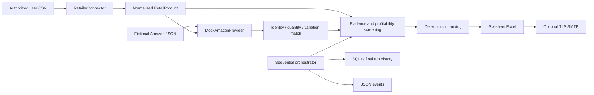

# Architecture

## V0.3 preparation (offline only)

New provider contracts separate catalog, fees, eligibility and demand evidence;
an injected transport policy bounds attempts/timeouts and reserves usage atomically
in SQLite before attempts. No HTTP adapter or live selector is registered.
SQLite backup tooling and proposed timer include retention and tested no-overwrite
restore. See [preparation handoff](V03_PREPARATION.md) and
[backup proposal](SQLITE_BACKUPS.md). Deployed V0.2 remains unchanged.

## V0.1 baseline (verified before V0.2 changes)

Python 3.12 runs a sequential, environment-configured job. `pipeline` loads the legacy CSV and applies deterministic eligibility, exact-match, $5 profit and 50% acquisition ROI gates. `reporting` atomically exports an openpyxl workbook; `mailer` optionally sends it using verified TLS. `history` persists running/succeeded/failed execution metadata in SQLite. `orchestrator` coordinates these modules and emits JSON events. Both CLI entry points work. All 29 baseline tests passed before implementation.

No network service, queue or database server is necessary. SMTP is optional. Jobs run once by default; positive intervals repeat after completion. This architecture remains the compatibility path.

## V0.2 discovery path

`CsvConnector` streams `RetailProduct` models through explicit normalization (GTIN check digits, positive package quantities, finite Decimal costs, timezone-aware evidence). `AmazonProvider` is a protocol; `MockAmazonProvider` implements local fixture matching with no network access. `Match` separates identity confidence from seller eligibility. `discovery` combines evidence gates, Decimal economics and deterministic ranking, then passes report rows to the existing Excel and job-history boundaries.

The orchestrator selects the legacy or discovery workflow from configuration. No extra process, server or runtime dependency is introduced. Retailer/API integrations, AI supervision and dashboards remain future layers.

## Financial model

All V0.2 money is USD per unit and uses Decimal internally. Acquisition cost = buy + inbound shipping + preparation + packaging + sales tax + other cost. Net profit = sale − acquisition − referral − fulfillment − storage − other transaction expenses. ROI = net / acquisition × 100. With zero new expenses this exactly reproduces V0.1. Source tax and shipping inputs are supplied amounts, not automatically calculated rates.

Referral is a fixed supplied amount unless a fractional referral rate is explicitly provided. Break-even = acquisition + sale costs + fixed referral, or (acquisition + sale costs) / (1 − referral rate). Maximum purchase price is the lesser of the profit and ROI constraints after other acquisition costs; negative results are clamped to zero, which indicates no feasible positive purchase at that price. Assumes the supplied fixed costs remain constant and percentage referral is the only price-dependent fee. It is an estimate, not a dynamic marketplace fee quote.

## Screening and ranking

Source identity/provenance/URL, positive buy price and package size, confirmed stock, exact match, seller eligibility, complete costs, sale price, supplied demand/competition and fresh source/marketplace timestamps are required. A match alone is never eligibility. Missing costs are not zero; invalid rows remain visible. One unit must fit the inventory budget. Failing rows are rejected with explicit reasons; passing rows are REVIEW only, never purchase-ready.

Confidence is a transparent evidence score (not a statistical probability): ten equally weighted 10-point components for valid source normalization, exact match, source provenance, marketplace provenance, verified cost basis, eligibility, freshness, demand presence, competition presence and no blocking issues. Mock scores cap at 50 and remain estimates regardless of fixture assertions. Ranking = 0.25 × ROI capped at 200 + 0.30 × confidence + 10 × min(monthly sales, 300)/300 + 10/(1+offers) + 10 × (1 − acquisition/budget). Only passing rows receive a score. Scores are rounded to two decimals; ASIN/name stabilize ties. These initial heuristics are documented, not a validated demand prediction model.

Budget units = floor(budget / acquisition) independently per candidate; the workbook does not allocate a $500 basket across all candidates. Exact matching confidence is distinct from evidence confidence. The top sheet contains at most the configured count (20 by default). Excel's 31-character sheet-name limit requires `Data Quality and Missing Info` as the abbreviated quality-sheet title.

## Failure and resource boundaries

Connector/header/provider failures fail the execution and persist a failed history record. Row-level bad/missing evidence is a rejected result and does not fail the report job. Missing data and stale mocks may therefore yield a successful execution with zero review candidates. Atomic report replacement preserves earlier reports on generation failure. Email/final job outcome is recorded in SQLite after workbook generation, so the job-summary sheet explicitly shows the report phase instead of claiming delivery succeeded.

Discovery caps source rows at 10,000 by default. CSV is streamed; candidate results, fixture listings and workbook cells remain memory-resident. This fits a small-job design, not unbounded catalog processing. Large live catalogs will require indexed/paginated providers and measured memory limits. No network retrieval, per-product LLM or background database service is used.

## Proposed operations enforcement

Offline backup now admits copies against an application byte budget/free-space
reserve under a shared lock, and restore verifies schema/data before publication.
Monitor checks both filesystems and backup usage. An optional local dispatcher
supports explicit opt-in HTTPS heartbeat and redacted failure/recovery messages;
its unit is dry-run/offline by default. An independent missed-heartbeat receiver
must run outside this VM. No units are installed and no notifications sent.
See OPERATIONS_WATCHDOG.md for dependencies, limitations and deployment gates.
