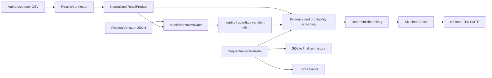

# Architecture

## V0.3 preparation (offline only)

New provider contracts separate catalog, fees, eligibility and demand evidence;
an injected transport policy bounds attempts/timeouts and reserves usage atomically
in SQLite before attempts. No HTTP adapter or live selector is registered.
SQLite backup tooling and proposed timer include retention and tested no-overwrite
restore. See [preparation handoff](V03_PREPARATION.md) and
[backup proposal](SQLITE_BACKUPS.md). Deployed V0.2 remains unchanged.

## V0.1 baseline (verified before V0.2 changes)

Python 3.12 runs a sequential, environment-configured job. `pipeline` loads the legacy CSV and applies deterministic eligibility, exact-match, $5 profit and 50% acquisition ROI gates. `reporting` atomically exports an openpyxl workbook; `mailer` optionally sends it using verified TLS. `history` persists running/succeeded/failed execution metadata in SQLite. `orchestrator` coordinates these modules and emits JSON events. Both CLI entry points work. All 29 baseline tests passed before implementation.

No network service, queue or database server is necessary. SMTP is optional. Jobs run once by default; positive intervals repeat after completion. This architecture remains the compatibility path.

## V0.2 discovery path

`CsvConnector` streams `RetailProduct` models through explicit normalization (GTIN check digits, positive package quantities, finite Decimal costs, timezone-aware evidence). `AmazonProvider` is a protocol; `MockAmazonProvider` implements local fixture matching with no network access. `Match` separates identity confidence from seller eligibility. `discovery` combines evidence gates, Decimal economics and deterministic ranking, then passes report rows to the existing Excel and job-history boundaries.

The orchestrator selects the legacy or discovery workflow from configuration. No extra process, server or runtime dependency is introduced. Retailer/API integrations, AI supervision and dashboards remain future layers.

## Financial model

All V0.2 money is USD per unit and uses Decimal internally. Acquisition cost = buy + inbound shipping + preparation + packaging + sales tax + other cost. Net profit = sale − acquisition − referral − fulfillment − storage − other transaction expenses. ROI = net / acquisition × 100. With zero new expenses this exactly reproduces V0.1. Source tax and shipping inputs are supplied amounts, not automatically calculated rates.

Referral is a fixed supplied amount unless a fractional referral rate is explicitly provided. Break-even = acquisition + sale costs + fixed referral, or (acquisition + sale costs) / (1 − referral rate). Maximum purchase price is the lesser of the profit and ROI constraints after other acquisition costs; negative results are clamped to zero, which indicates no feasible positive purchase at that price. Assumes the supplied fixed costs remain constant and percentage referral is the only price-dependent fee. It is an estimate, not a dynamic marketplace fee quote.

## Screening and ranking

Source identity/provenance/URL, positive buy price and package size, confirmed stock, exact match, seller eligibility, complete costs, sale price, supplied demand/competition and fresh source/marketplace timestamps are required. A match alone is never eligibility. Missing costs are not zero; invalid rows remain visible. One unit must fit the inventory budget. Failing rows are rejected with explicit reasons; passing rows are REVIEW only, never purchase-ready.

Confidence is a transparent evidence score (not a statistical probability): ten equally weighted 10-point components for valid source normalization, exact match, source provenance, marketplace provenance, verified cost basis, eligibility, freshness, demand presence, competition presence and no blocking issues. Mock scores cap at 50 and remain estimates regardless of fixture assertions. Ranking = 0.25 × ROI capped at 200 + 0.30 × confidence + 10 × min(monthly sales, 300)/300 + 10/(1+offers) + 10 × (1 − acquisition/budget). Only passing rows receive a score. Scores are rounded to two decimals; ASIN/name stabilize ties. These initial heuristics are documented, not a validated demand prediction model.

Budget units = floor(budget / acquisition) independently per candidate; the workbook does not allocate a $500 basket across all candidates. Exact matching confidence is distinct from evidence confidence. The top sheet contains at most the configured count (20 by default). Excel's 31-character sheet-name limit requires `Data Quality and Missing Info` as the abbreviated quality-sheet title.

## Failure and resource boundaries

Connector/header/provider failures fail the execution and persist a failed history record. Row-level bad/missing evidence is a rejected result and does not fail the report job. Missing data and stale mocks may therefore yield a successful execution with zero review candidates. Atomic report replacement preserves earlier reports on generation failure. Email/final job outcome is recorded in SQLite after workbook generation, so the job-summary sheet explicitly shows the report phase instead of claiming delivery succeeded.

Discovery caps source rows at 10,000 by default. CSV is streamed; candidate results, fixture listings and workbook cells remain memory-resident. This fits a small-job design, not unbounded catalog processing. Large live catalogs will require indexed/paginated providers and measured memory limits. No network retrieval, per-product LLM or background database service is used.

## Proposed operations enforcement

Offline backup now admits copies against an application byte budget/free-space
reserve under a shared lock, and restore verifies schema/data before publication.
Monitor checks both filesystems and backup usage. An optional local dispatcher
supports explicit opt-in HTTPS heartbeat and redacted failure/recovery messages;
its unit is dry-run/offline by default. An independent missed-heartbeat receiver
must run outside this VM. No units are installed and no notifications sent.
See OPERATIONS_WATCHDOG.md for dependencies, limitations and deployment gates.

## Optional Keepa contract adapter (live disabled)

KeepaAdapter maps explicit US ASIN replies into separate catalog, Amazon-price,
rank and lower-bound demand evidence. Unknown seller eligibility/fees and listing
economics remain missing. UsageLedger bounds attempts; a shared SQLite record paces
requests. Optional permission-bounded memory cache preserves timestamps; no raw
payload persistence. KeepaHttpTransport is dormant behind a false code gate. No
production selector, live calls, credential lookup or deployment is enabled.

## Controlled DEMO composition

`app.demo` composes CsvConnector, MockAmazonProvider, discover and write_report
with an explicit fixture clock and isolated Config, bypassing environment-loaded
SMTP/provider settings and job-history writes. It produces ignored DEMO XLSX,
JSON and Markdown plus sensitivity scenarios through the same screening gates.
The report writer's opt-in `demo` label leaves existing report behavior unchanged.
`authorized_imports` retains its diagnostics and adds corrective actions; source
validation remains separate from proof of authorization/marketplace evidence.
All live pilot entry points obey the false Keepa code gate before key loading.

## Gmail report delivery proposal

The opt-in send-only HTTPS adapter rejects redirects and inherited proxies,
validates refresh scopes/type and persists refresh-token rotation atomically.
Private stage evidence records only fixed categories, numeric status and known
Google reason identifiers from bounded error JSON. An operator confirmed DEMO
attempt-3 inbox delivery with both attachments. Separate uninstalled report units
use a nonroot private writable token directory outside report/backup state,
explicit disabled activation/OAuth-readiness gates and no retries/catch-up sends.
The original offline service and timer remain unchanged. See
[scheduling preparation](GMAIL_SCHEDULE_PREPARATION.md).

## Offline pilot evidence persistence

`app.offline_pilot` reuses CsvConnector, MockAmazonProvider.match,
KeepaAdapter.lookup/quote/eligibility, discovery.screen and write_report. It is a
separate fixture-only CLI, never selected by orchestrator or production Config.
It constructs config directly and never imports live HTTP or invokes mail.

`app.observations.ObservationStore` creates versioned tables beside the existing
History/UsageLedger in a separate owner-only pilot database: source_observations,
marketplace_matches, enrichment_observations, pilot_runs, pilot_run_items and
pilot_run_enrichment. Exact canonical content hashes deduplicate evidence while
input ordinals, evaluation clocks, input-file hashes, full decisions and fetch
links remain attributable to each run. Decimal values use exact strings;
unknowns use JSON/SQL null; aware times normalize to UTC. Retain supplier permission
references and original evidence timestamps. This is normalized evidence storage,
not raw-response caching or permission to persist live vendor data.

Reports add an opt-in enrichment sheet. Historical price/rank/monthly-sold brackets
never overwrite sale quotes, seller eligibility, fees or monthly-sales fields.
Existing discovery adds a structured rejection_reasons array without changing
screening gates or its default workbook schema. Original source issues and match
reasons are also retained in persisted normalized objects. See
[implementation and schema](REAL_DATA_PILOT.md).

## Standalone Amazon catalog pilot

`app.amazon_pilot` is an explicit manual CLI outside the orchestrator/provider
selector. Hidden SSH entry writes exclusive owner-only Amazon credential storage
outside the repository and Gmail directories. A separately invoked pilot performs
one LWA refresh exchange and one fixed US Catalog Items GET, with verified TLS,
no proxies/redirects/retries, bounded response sizes/socket timeouts and an overall
Linux alarm deadline. It reuses Evidence/MarketplaceListing and persists only
normalized catalog evidence with unknown fees/eligibility. No listings, email,
scheduling or production configuration changes are included. See
[operator commands and official authentication sources](AMAZON_PILOT.md).

## Expanded Amazon read-only pilot preparation

Catalog requests now include summaries, identifiers and relationships. The
AmazonCatalogListing subtype preserves title/package count, canonical identifiers
and variation hierarchy; AmazonCatalogAdapter reuses existing matching while
blocking unresolved mapping evidence. A separate manual `details` action reuses
private storage and verified TLS, caps the run at five attempts (one LWA exchange
and four operations), and stops without retries on failure under a 60-second
Linux alarm. It preserves partial normalized evidence in an exclusive new file.
New/Consumer offer snapshots, proposed-price FBA estimates and seller-specific
new_new listing restrictions are separate evidence, not merged into purchase
approval. Overall eligibility and unverified costs remain unknown. Owner reports
the original catalog pilot succeeded; no expanded live calls or production
provider/job changes have been performed. See [Amazon pilot](AMAZON_PILOT.md).

## Amazon failure observability

Private future pilot reports distinguish observed HTTP status/allowlisted error
codes from transport failure or HTTP-200 parser rejection. Error JSON inspection
is bounded to 16 KiB and unknown codes become a fixed OTHER label. No messages,
raw responses, URLs or credentials are persisted. The failed original report is
preserved; diagnostics cannot reconstruct its lost HTTP/parser details. See
[pricing investigation and proposed test](AMAZON_PILOT.md).

## Separate pricing-only diagnostic

The explicit `pricing-diagnostic` CLI action reserves a new private exclusive
report, then reads existing Amazon credentials and makes at most two requests:
one LWA exchange and one US/New/Consumer getItemOffers request for B002XQ1R06.
It reuses the verified transport, pricing parser and allowlisted diagnostics under
a 30-second overall deadline, with no retries or other provider operations.
Token response data is discarded; fixed stage completion and normalized pricing
remain separate from fee/eligibility/purchase evidence. No job selection or
production settings change. See [operator command](AMAZON_PILOT.md).

## Pricing schema validation and shape-only diagnostics

Pricing parsing now uses fixed validation labels and accepts schema-optional
ASIN placement while requiring at least one explicit matching response identity.
Required marketplace/condition/containers/count checks remain conservative;
unsupported statuses and invalid currency/numbers fail without inferred prices.
The separate pricing-shape-diagnostic action shares the two-request/30-second
bounds, reserves a new owner-only report, and emits only fixed-path shape facts
and validation labels. No response prices, arbitrary keys/values or token shape
are persisted. Previously saved diagnostics remain unchanged. See
[schema comparison and operator command](AMAZON_PILOT.md).

## Completed no-offer lookups

Validated NoBuyableOffers responses preserve the business status, complete the
lookup and keep pricing unknown, with explicit ranking exclusion. Contradictory
counts/offers/prices and mismatched identities remain failures. apply_pricing_gate
clears a previous sale quote and adds a rejection reason before the existing
discovery screen; it does not overwrite independent fees/eligibility or turn
competing prices into achievable sale quotes. A separate pricing-selected-pilot
action accepts one explicit ASIN, reserves a new ASIN-specific private report,
and makes at most a token exchange plus one US/New/Consumer offers request.
Historical fixed-ASIN pilots and their reports remain unchanged. See
[semantics, limits and command](AMAZON_PILOT.md).

## Aggregate and detailed offer coverage

PricingSnapshot preserves the aggregate total separately from returned detail
count, documented capped expectation, count-contract match and coverage state.
Observed below-contract replies with validated detail structure and USD prices
can be retained as partial evidence. Partial and capped coverage block ranking
and clear older sale quotes through apply_pricing_gate. Optional aggregate
condition/channel counts are normalized and checked independently. Details never
supply an invented summary/sale price; no overall lowest-price guarantee follows
from a count match. Historical reports and live request boundaries are unchanged.
See [retained 5/1 evidence, official contract and uncertainty](AMAZON_PARTIAL_OFFER_COVERAGE.md).
## Authorized-source Amazon preparation

`amazon_source_plan.prepare` accepts exactly ten authorized CSV rows and local
normalized catalog/pricing/seller-restriction evidence. It reuses matching,
screening, ObservationStore/History and Excel reporting, preserving every input
ordinal and missing/restricted/unmatched reason. Fee scenarios require explicit
row-specific prices and passing source/match/pricing/restriction/eligibility
gates; no network executor exists. The common screen excludes B0G1MJ24B4 on the
retained seller-specific NOT_ELIGIBLE result. Condition-scoped count diagnostics
explain the observed 1 New + 4 Used aggregate without removing partial-coverage
ranking gates. See [evidence and request budget](AMAZON_AUTHORIZED_SOURCE_WORKFLOW.md).

The explicit `amazon_source_intake` CLI accepts one supplied source row using the
same template. `prepare(expected_rows=1)` reuses the existing storage/reporting;
the default remains exactly ten. Source-only intake needs no seller alias or
Amazon evidence. Missing fields stay unknown, no padding occurs, and budgets
scale to the actual supported intake size. No live executor is added.

The Walmart template extends the existing source CSV with six context fields;
CsvConnector preserves them in RetailProduct.source_context without fetching URLs.
Source context participates in existing fingerprints/SQLite payloads and appears
in the report enrichment sheet. Missing seller/location/shipping evidence stays
flagged, and source shipping never silently fills profitability costs. There is
no Walmart HTTP adapter or new pipeline.

## M70 offline scalable catalog discovery

[Source/identity/ranking contracts and actual results](M70_CATALOG_DISCOVERY.md)
add hash-bound local imports, conservative identity merging, M69 history reuse and
a non-executable Catalog discovery plan. Capacity is tested above 1,000 ASINs;
available saved evidence contains 197. Further authorized source coverage is needed.
No live adapter, automatic execution, reservations or immutable-evidence changes.

## M71 Catalog discovery preparation

[Manifest, adapter and live-pilot prerequisites](M71_CATALOG_PREPARATION.md)
freeze 50 queries across ten category intents and an absolute 1+200+50 request
ceiling. A separate append-only request journal, conservative pacing, pagination
validation, private checkpoints and M70 import are tested offline. The CLI only
prepares/validates proposals; live transport, credentials and all selling operations
remain disabled. Separate reviewed activation and fresh owner authorization are required.

## M72 controlled Catalog pilot

[One-shot pilot and owner procedure](M72_CONTROLLED_CATALOG_PILOT.md)
add a separate fixed operation registry, global account lock, durable pre-dispatch
accounting and a 1-authentication/9-first-page-query ceiling. Fresh account/code/
proposal/history-bound owner authorization and explicit execution flag are required.
Private checkpoints feed unchanged M70 ingestion and identity quality reporting.
Implementation/testing is offline; no live authorization or requests occurred.

## M73 offline catalog consolidation

A read-only verifier binds the completed ten-request M72 operation/checkpoint and
original M70 baseline before combining observed identities. Private Excel/CSV/JSON
reports retain per-ASIN provenance, all exclusions, unresolved GTIN alternatives,
diversity, research priority and discovery scenarios. The actual union is 377 real
ASINs (623 remaining); no new network or seller-specific operations are enabled.
See [M73 evidence and review procedure](M73_CATALOG_CONSOLIDATION.md).

## M74 intelligent discovery planning (offline only)

M74 verifies every M73 completion-manifest file and reuses the unchanged read-only
source validator before planning. Fifty-one reviewable candidates distinguish 41
unexecuted M71 definitions from ten new vocabulary hypotheses. Observed overlap and
coverage stay separate from duplicate-scenario projections. A proposed M75 contract
caps a future new one-shot operation at 1 authentication plus 20 first-page searches;
no executor, authorization artifact or registry is created. Private deterministic
workbook/JSON/CSV reports bind input, code and output hashes. See
[M74 evidence, command and future-operation proposal](M74_DISCOVERY_PLANNING.md).

## M75 controlled Catalog expansion

A separate manual executor pins the M74 completion, canonical/file manifest and
exact contract before admitting one authentication plus twenty first-page keyword
requests. A new permanent M75 registry, existing exclusive account lock, durable
before-dispatch accounting, bounded TLS transport and fresh ten-minute owner
authorization enforce no replay. Original M72 and M63–M74 evidence remain unchanged.
Development ran only offline validation and synthetic tests; no live requests or
authorization artifacts were created. See [M75 review and future owner procedure](M75_CONTROLLED_CATALOG_EXPANSION.md).

### M76 offline consolidation

`m76_evidence` composes the existing M73/M74 source-chain validators and read-only
M75 immutable-registry inspector. It reconciles the original M75 M70-compatible
source/summary against its terminal event-chain checkpoint before import.
`m76_analysis` merges exact ASINs through existing identity contracts, retains
verbatim M73 provenance, separates historical annotations and ranks unused M77
query hypotheses from observed intent coverage. `m76` publishes deterministic,
formula-safe CSV/Excel/JSON and a completion evidence manifest only after drift
checks. All application source and input evidence are hash-bound. No transport,
credential loading, registry writing or authorization action is part of this CLI.
See [M76 controls and artifacts](M76_OFFLINE_CATALOG.md).

## M77 controlled catalog discovery expansion

`m77_policy` validates the immutable original M76 output inventory and reproduces
its complete M73/M74/M75 evidence chain before exposing a credential-free preflight.
It freezes all 31 reviewed q020–q050 first-page definitions, US marketplace,
includedData and page size, with one LWA plus 31 search slots (620 observations).
Separate M77 CLI, authorization, registry, transport, execution and reporting modules
preserve the historical implementation and registries. Fresh interactive ten-minute
owner permission binds exact code/evidence/account/request/budget hashes. Dispatch
requires the explicit live flag and exact artifact digest, exclusive global account
lock, durable sequential intent commits, immutable hash chain, pacing and hard
180-second deadline. Any existing claim permanently prevents replay, including
failure or hard kill. Read-only recovery exports only journaled normalized source
observations through the existing M70 adapter and validates the original M76 baseline.
The guarded offline wrapper rejects network and credential reads. See
[M77 operator controls](M77_CONTROLLED_CATALOG_EXPANSION.md) and
[safety audit](M77_SAFETY_AUDIT.md). No runtime selector, schedule or deployment changes.

M81–M83 downstream decision support reads owner-pinned original M80 journals without
relaxing live code pins. `sales_evidence`, `opportunity_engine` and `decision_pipeline`
separate provenance/freshness, conservative exact-match Decimal economics, and private
report publication. `decision_history` owns a distinct append-only derived SQLite database;
it never writes acquisition ledgers or the M77 registry. `decision_workbook` exposes
category-scoped evidence and auditable formulas, while JSON preserves unrounded gates.
Network/process audit guards supplement, but do not replace, OS isolation.

M84 `ops.intelligence_release` exports reviewed Git objects plus independently pinned
pure-Python wheels. The release profile has no historical file-count constraint and
never installs into M78. Runtime entry verifies its externally reviewed manifest before
imports under Python `-I -S -B`. Code is proposed read-only on the dedicated volume;
new owner-private state/reports remain outside `/mnt`. Kernel isolation, OS trust,
actual target security and all host changes require separate approval.

M87: `walmart_evidence` imports pinned six-row Walmart batches or saved Agent exports,
normalizes to M86 and emits safe local reports plus a nonexecuting SP-API preview.
See [M87 evidence integration](M87_EVIDENCE_INTEGRATION.md). No provider is enabled.

## M88 browser intake

`app.walmart_intake` validates six human-reviewed local browser observations in
M87's batch schema, including canonical Walmart URLs, price/pack/variant/seller,
aware fresh timestamps and SHA256-pinned local evidence. It publishes a private
M87 batch offline; Amazon evidence and missing costs remain unknown. Existing M88
ledgers/reports are untouched. See [procedure](M88_BROWSER_INTAKE.md).

## M88 bounded SP-API research executor

`app.m88` combines existing TLS/pacing/catalog/pricing/fee parsers with an explicit
31-attempt conditional plan and the original cumulative 49-attempt JSON ledger.
Atomic fsync reservations precede dispatch; exclusive account/ledger locks and a
permanent cohort claim prevent replay. `m88_evidence` requires exact verified
source and Amazon identity before offers/fees. `recover` is credential-free and
report-only, reusing M87/M86 with unknowns and hypothetical sale-price bases.
See [scope, credentials and recovery](M88_AMAZON_EXECUTOR.md).

## M88 offline identity enrichment

`app.m88_identity` verifies the completed 7/49 ledger and hashed search receipts,
then compares retained barcode/brand/model/size/pack observations offline. Textual
triage is separate from exact matching; pack contents and sellable-package counts
remain distinct. It emits a per-product gap report and Browser Use checklist
without source, ledger or credential writes. See [evidence limits and procedure](M88_IDENTITY_ENRICHMENT.md).

## M88 enriched-source reconciliation

`app.m88_reconcile` pins the new Browser Use JSON and original 7/49 search receipts,
compares barcode/model/MPN/brand/variant/package evidence, and classifies research
pairings without promoting incomplete identities. Required source exceptions,
agent-versus-human flags and screenshot references remain explicit. It reuses
M87/M86 for new private financial reports, preserving old price observations and
leaving unsupported profitability unknown. No transport or ledger writer is used.
See [classification and actual results](M88_ENRICHED_RECONCILIATION.md).

## M88 targeted Catalog continuation

`app.m88_targeted` ranks the 26 unresolved pairs and authorizes a fixed three-ASIN
Catalog pass with conditional offers/fees. `m88_targeted_state` preserves the first
seven ledger entries/original claim and adds a separate one-shot claim under the
same durable 49-attempt accounting. `m88_targeted_evidence` retains scoped MPN,
formulation, package and dimension data without source-field upgrades or aliases.
Report-only recovery reuses M87/M86. See [scope and observed result](M88_TARGETED_VERIFICATION.md).
