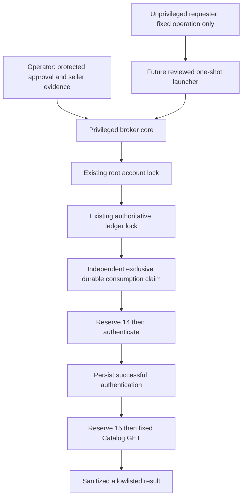

# M90.2 — Secure Amazon execution broker

Status: offline implementation for security review. **Live deployment blocked.**
No production approval is supplied. No launcher is installed or enabled. The
executable broker entry point prints an inert readiness report; the requester
prints a fixed protocol message. Neither reads production files nor opens a
socket. The privileged core is exercised with synthetic policies and mocks.
A passing test suite does not authorize execution.

## Architecture and trust boundary



`app/m902_requester.py` has no privileged imports. Protocol v1 is a bounded JSON
object containing exactly `version: 1` and `operation: M902_AUTH14_CATALOG15`.
Duplicate keys, unknown fields, boolean versions, arbitrary operations, URLs,
commands and payloads above 256 bytes are rejected. The operation identifier,
including the old `APPROVE_M901_AUTH14_CATALOG15`, is never proof of approval.

`app/m902.py` provides the broker entry point, strict protocol validator,
protected authorization and evidence validator, existing-file lock helper and
complete accounting workflow. `execute` is an internal trusted Python API, not
a privilege boundary by itself. Its policy, peer UID and transport objects must
come from protected launcher code, never requester arguments or environment.
Transport arguments are mandatory and have no defaults. This prevents accidental
live dispatch during this milestone; the two existing fixed HTTP adapters are
tested through synthetic HTTPSConnection implementations.

## Independent authorization

The proposed approval authority is an operator who can write a root-owned 0600
approval document in a root-controlled 0700 directory. The requester cannot
write this document, policy, code, claim directory or any ancestor. This is a
filesystem authorization model, not a digital signature model: root is trusted.
Protect approval provisioning separately from the requester launch permission.
No API creates an approval. Test approvals are synthetic only.

The exact document fields are `binding`, `approved_by`, `approved_at`,
`expires_at`, and a 64-hex `nonce`. Aware timestamps must bound the current time,
with a maximum validity of one hour. Expiration is checked again before each
reservation and dispatch. Binding must exactly equal `Policy.binding()`:

- Immutable release commit and exact two-request operation.
- Original reviewed full 13-attempt ledger SHA, ledger path and ledger-lock identity.
- Seller, application and US marketplace IDs, and permitted requester UID.
- Shared account-lock path, device and inode.
- Credential path and exact credential file SHA, plus reviewed evidence SHA.

A credential digest belongs in protected documents only. It is not a substitute
for seller/application authorization evidence. Do not print it in requester output.
An altered binding is rejected. Approval consumption is a single fixed exclusive
claim per operation, containing approval digest and binding. It is not keyed only
by caller nonce: issuing a different approval cannot bypass the claim. Creation,
file fsync and directory fsync must succeed before reservation. Never remove or
restore this claim. Ledger-only rollback remains blocked. Root compromise or
joint rollback of claim and ledger is outside this protection; use independent
operator retention/backup policy. No automated recovery or resume API exists.

### Release and identity prerequisites — unresolved live blockers

There is deliberately no production policy loader or privileged launcher yet.
A future launcher must independently verify the **actual running immutable
release commit**, full clean source/dependency contents, root ownership and
nonwritability, then construct the policy with that commit. A policy string
alone does not prove which code is running. It must enforce the fixed production
paths below and inspect the entire ancestor chain (`Policy.root = Path('/')`).
Synthetic tests use a private temporary anchor instead.

Full-chain ownership is an unverified production prerequisite. The existing
service's StateDirectory is associated with the application user; if any ancestor
of the authoritative ledger is application-writable or application-owned, the
broker rejects it. A root-owned final file or final 0700 directory alone is not
sufficient against ancestor rename/substitution. Do not change ownership here or
assume compatibility. A separately approved filesystem design (or reviewed
pinned-directory-descriptor persistence redesign) is required if inspection
confirms this conflict.

It must authenticate the requesting identity using kernel evidence, not JSON or
an environment variable. Proposed design: a root-operated, nonpersistent,
one-shot launcher with a narrowly authorized requester trigger. If sudo is
selected later, use a root-owned wrapper, exact argument policy, sanitized
environment, fixed interpreter and imports, no shell expansion or user-controlled
working directory, and validate sudo's trusted identity mechanism. Do not grant
permission to run Python, arbitrary modules or commands as root. These rules
are prerequisites for a separately reviewed implementation, not installed policy.
A socket alternative requires SO_PEERCRED, strict framing, filesystem access
controls and bounded client handling; it adds a privileged listener and is not
implemented. A root operator invoking a one-shot process avoids that listener.

## Protected seller evidence

Evidence contains seller ID, application ID, marketplace `ATVPDKIKX0DER`, exact
`credential_sha256`, reviewer and an aware `reviewed_at` within the last 24 hours.
Each of `seller_authorization`, `application_product_listing_role`,
`us_marketplace_participation`, and `protected_credentials_binding` must contain
`confirmed: true` and a nonempty operator-reviewed `reference`. No real seller ID
or confirmation is invented. The current implementation requires the Product
Listing evidence field; another role needs a separately documented review.

Local validation proves that the protected reviewed evidence has the required
shape and binding. Remote Amazon acceptance is **unverified** until a separately
approved live Catalog request. This milestone makes no calls to collect evidence.

## Lock coordination and writer inventory

The account lock is the existing
`/root/.intelligenceos-arbitrage-amazon/candidate-execution.lock`.
Do not migrate it or create a second account lock. Broker opens both reviewed
lock files without O_CREAT, using O_NOFOLLOW, exclusive nonblocking flock,
expected device/inode, owner, mode 0600, regular-file and single-link checks.
It checks pathname identity before and after acquisition. Containing directories
must be 0700; all inspected ancestors must be owner-controlled and not writable
by group/other. Root remains trusted against concurrent replacement.
Locks cover evidence validation, claim, credentials, both requests and all writes.
On exceptions file descriptors close; contention fails immediately.

Static inventory reviewed at the required baseline:

| Writers/readers | Coordination |
| --- | --- |
| `m88.execute`, `m88_targeted.execute`, `m89_continue.execute`, `m90.execute`, `m901.execute` | Account then authoritative ledger lock |
| `m89_deployment.authenticate` and ledger transfer/preflight | Ledger lock only |
| `m67_execution`, `m72_execution`, `m75_execution`, `m77_execution`, `m80_execution` | Account lock enclosing their private accounting |
| `stored_candidate_search`, `sp_target_execution`, `m63_catalog` | Account lock enclosing SQLite accounting and request dispatch |
| `amazon_pilot.run_pilot`, `amazon_details.run_details`, `amazon_pricing_diagnostic.run_pricing_diagnostic` | Older direct network runners reserve reports but do not take the shared account lock |
| `amazon_candidates.execute` directly, `amazon_candidate_enrichment.execute`, `candidate_execution.execute_details` / `execute_research` | Older runners do not take the account lock; candidate SQL claims are not a full-workflow account lock |
| `candidate_recovery.run` | Delegates to candidate research; its preparation lock does not protect later execution |
| M68 authorization, M67 reporting | Shared-lock readers, not broker execution authorization |
| `m67_transport`, `m71_adapter`, `m72_transport`, `m80_execution.Transport`, legacy pilot/provider request helpers | Transport primitives rely on their executor; not independently authorized entry points |

No reverse blocking account/authoritative-ledger order was found in the reviewed
executors. Both new lock acquisitions are nonblocking. M89's ledger-only writer
serializes with this broker through the authoritative ledger, but **does not
coordinate with older account-only writers**. Old executors also permit
configurable private roots and some create absent lock files. Compatibility with
every possible production invocation cannot be asserted from repository code.
Live rollout is therefore blocked until the operator inventories all installed
entry points, disables unauthorized legacy launch permissions, and reviews a
remedy for M89's missing account lock and the original pilot/details/pricing/candidate/
enrichment runners' absent account locks. Stored-candidate search adds its guard;
direct calls to the underlying candidate runner do not. No historical behavior
is changed here.
Do not assume stopping the offline reporting service solves this issue.

## Credentials and network

Production configuration must remain fixed at
`/etc/intelligenceos-arbitrage/m89/live.env`; authoritative ledger is
`/var/lib/intelligenceos-arbitrage/m89/ledger.json`. New approval, evidence and
independent claim paths must be fixed by protected launcher policy, not request
fields. A separate protected claim directory should be retained independently of
ledger restores. No production directory is created in M90.2.

Credentials are read only inside the broker, after approval consumption, under
both locks. The exact protected bytes must match the approval digest. The existing
strict parser requires only the three LWA keys and `PURCHASE_AUTHORIZED=false`.
No secrets in argv, environment forwarding, logs, ledger, claim or results.
Core dumps are disabled before credential reads. Credentials are cleared after
authentication and on failure; token references are dropped after Catalog dispatch
and on failure, before final persistence. Python reference clearing does **not**
guarantee secure memory zeroization; immutable copies, tracebacks and interpreter
internals may retain bytes until process exit. Future launcher must emit only the
fixed error code and terminate, without traceback logging or core dumps.

Only future reviewed transport bindings may be `m901.authenticate` and `m90.send`:

1. POST `https://api.amazon.com/auth/o2/token`.
2. GET `https://sellingpartnerapi-na.amazon.com/catalog/2022-04-01/items/B001BE12BA?marketplaceIds=ATVPDKIKX0DER&includedData=summaries`.

They use verified TLS, direct http.client connections, no proxy environment,
redirect following, retry or refresh. Socket timeout is 10 seconds, response
bounds are 65536 and 262144 bytes (one extra byte detects overflow); protected
credential input is at most 16384 bytes, bounding encoded authentication payload.
Broker uses a single 40-second SIGALRM across credential handling, both dispatches
and persistence, rather than restarting a per-request timer. Requires a dedicated
main-thread process with no inherited alarm. Kernel storage hangs may outlast
Python signal handling; never automatically restart a killed process.

Application-level host/path/method restrictions are implemented by the fixed
adapters; network-level egress policy remains a deployment prerequisite. Dynamic
Amazon addresses and shared infrastructure make static IP rules insufficient to
prove host/path authorization. Review a dedicated boundary enforcing these hosts
and verified TLS while retaining fixed paths in code. Never weaken the existing
offline service restrictions to provide network access.

## Ledger transitions and crash policy

`m90.history` pins all original ledger bytes, validates the complete historical
12-attempt prefix and successful authentication attempt 13, ceiling 49 and
purchase prohibition. It rejects any baseline drift. Existing records are
preserved. Authentication reservation is durably written before POST. Catalog
reservation occurs only after authentication succeeds and its COMPLETE record
is durably written. Failed, timed-out and uncertain dispatches remain charged;
no retry exists. Persistence failure stops execution, including before Catalog.
M90.1 accounting behavior remains compatible; the broker adds an independent
approval-consumption gate and a whole-workflow deadline.

| State | Used | Remaining |
| --- | ---: | ---: |
| Verified baseline | 13 | 36 |
| Authentication reserved, failed, or successful before Catalog | 14 | 35 |
| Catalog reserved, successful, failed or uncertain | 15 | 34 |

| Crash window | Conservative outcome |
| --- | --- |
| Before approval consumption | No reservation/dispatch; normal independent revalidation required |
| Approval consumption vs independent claim | Same exclusive durable write, no separate consumption gap; partial/uncertain creation blocks forever if present |
| Claim created, before auth reservation | 13 used, consumed claim blocks replay; no dispatch |
| Reservation vs dispatch | Reservation remains charged even if dispatch did not happen |
| HTTP completion vs durable outcome | RESERVED or FAILED/uncertain stays charged; no retry |
| Auth COMPLETE vs Catalog reservation | 14 used; no resume or second authentication; claim blocks restart |
| Catalog reservation vs final persistence | 15 used; response may be lost; report-only investigation |
| fsync failure at any stage | Stop; no next dispatch; retain all available claim/reservation evidence |

A missing claim after a reported failed creation does not prove crash durability;
operators must investigate. Never authorize replay based on an apparent ledger
rollback or missing outcome. Independent claim storage loss blocks readiness.

## Inert launcher design template

The following is descriptive data, **not an installable service unit**:

```text
status = DISABLED_PENDING_SEPARATE_SECURITY_AND_DEPLOYMENT_APPROVAL
process = dedicated root one-shot; no persistent daemon; no shell
release = independently verified immutable M90.2 commit, never /current
request = bounded stdin operation message only
requester_identity = kernel-attested allowlisted UID
account_lock = existing root-owned lock; must already exist
ledger_lock = existing reviewed ledger.lock; must already exist
credential_source = fixed /etc/intelligenceos-arbitrage/m89/live.env
approval/evidence = fixed root-only operator-provisioned files
claim = fixed root-only exclusive claim in independently retained storage
core_dumps = disabled
restart = never
stdout = allowlisted result or fixed stop code
stderr = no traceback or transport diagnostics
network = separately reviewed two-host TLS boundary
```

The offline service retains ProtectHome=true, NoNewPrivileges=true,
RestrictAddressFamilies=AF_UNIX and IPAddressDeny=any. No units, timers, ACLs,
ownership, firewall rules or OS settings are changed. Production `/current`
remains the supplied V0.2 target ending `68230d3fdaef588bb7ba5c8340f49a473e8386b7`.
No installation, staging, reboot or Ubuntu upgrade is authorized.

## Operator procedure, deployment and rollback

1. Complete independent code/security review, including trusted launcher,
   installed-writer inventory, release attestation and egress controls. Obtain
   separate explicit deployment approval before provisioning anything.
2. Verify the authoritative ledger and locks independently in a separately
   authorized no-request privileged preflight; check identities, durability,
   permissions, claim absence, retained backups, release and seller evidence.
   This milestone's CLI does not inspect production and cannot certify readiness.
3. Operator reviews original 13-attempt ledger SHA
   `c79e2a7788c3b99ee75a17dc3150b9e2a609818ad2de3cce82f082e36c9b79f1`, seller,
   application, credentials, exact requests, requester, release and expiration.
   Create a protected approval only after separate live authorization. No approval
   document is included here. Historical 12-attempt SHA is
   `b7502888a36b97594e5c79b3f8c47312c1226d80355a03621284660b45da2f1b`.
4. Future approved launcher runs once and exits. Operator inspects sanitized
   accounting; Amazon acceptance is established only by actual approved outcomes.
5. Rollback disables access to the separate launcher and withdraws unused approval;
   preserve ledger, independent claim and evidence permanently. Never restore
   ledger, delete claims, reset reservations or retry a partial workflow. Do not
   repoint `/current`. Any uncertain dispatch requires manual report-only review.

Known limitations: root is trusted; Python cannot zeroize secrets; external
processes can ignore advisory locks; no deployed launcher, kernel requester
attestation, immutable-release verifier or network sandbox exists yet. These are
explicit M90.3 readiness blockers, not assertions that runtime security is proven.

## Exact safe offline verification

From the repository with the existing Python 3.12 environment; no dependency
installation or production access is required:

```bash
/tmp/arbitrage-ci-fix-py312/bin/python -m app.m902
/tmp/arbitrage-ci-fix-py312/bin/python -m app.m902_requester
/tmp/arbitrage-ci-fix-py312/bin/python -m pytest -q tests/test_m89_deployment.py tests/test_m90.py tests/test_m901.py tests/test_m902.py
/tmp/arbitrage-ci-fix-py312/bin/python -m pytest -q
ARBITRAGE_MODE=legacy ARBITRAGE_REPORT=var/m902-legacy.xlsx ARBITRAGE_DB=var/m902-legacy.sqlite3 /tmp/arbitrage-ci-fix-py312/bin/python -m app.orchestrator
ARBITRAGE_MODE=discovery ARBITRAGE_REPORT=var/m902-discovery.xlsx ARBITRAGE_DB=var/m902-discovery.sqlite3 /tmp/arbitrage-ci-fix-py312/bin/python -m app.orchestrator
git diff --check
```

No production fixtures are used. New tests cover protocol injection, approval and
evidence bindings, expiry, replay, ledger rollback, missing/replaced/linked locks,
owner/mode failures, contention including concurrent processes, credential
validation and disposal, durable reservation ordering, storage/fsync failures,
HTTP rejection, interruptions, process crashes and sanitized output.

## Recorded offline validation — 2026-11-06

Starting checkout was clean on `milestone/m90-1-controlled-auth-catalog`, exactly
`d0a270f68d268a63d7923a350650f282b3921550`. Work is isolated on
`milestone/m90-2-secure-execution-broker`.

- Baseline M89 deployment / M90 / M90.1: 81 passed.
- Full existing repository suite: 3052 passed, 9 skipped in 705.26 seconds.
  Collection occurred before the new test file was added.
- Final focused M89 deployment / M90 / M90.1 / M90.2: 202 passed in 6.35 seconds,
  including all 121 new broker tests.
- Final collection: 3182 tests. Combined coverage is 3173 passes and 9 skips
  from the split runs above, not a claimed single final full-suite invocation.
- Legacy and discovery sample modes: both `job_succeeded`.
- Existing Python 3.12 environment: pip check passed.
- Broker readiness and requester encoder commands: inert expected output.
- git diff --check and staged whitespace check: clean.

Zero Amazon requests, credential reads from production, production reservations,
production mutations, deployments, pushes or merges were performed. The supplied
operator-verified historical budget remains **13/49 used, 36 remaining**; this is
not a fresh production inspection. PURCHASE_AUTHORIZED remains false.

The offline core is delivered for review. Full runtime acceptance remains blocked
by the unresolved launcher, release attestation, legacy-writer, filesystem ancestor
and network-boundary prerequisites described above. Do not mark live readiness
complete or bypass any of them.
